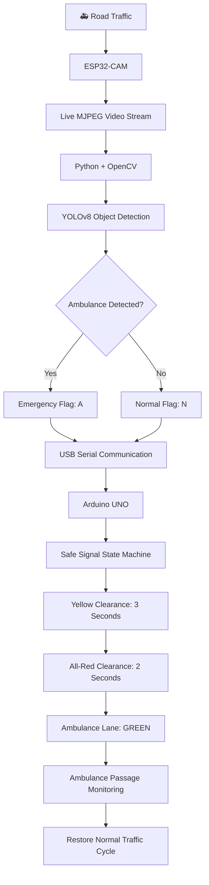

# 🚑 ESP32-CAM Based Smart Traffic Control System for Ambulance Priority

<p align="center">
  
  
  
  
</p>

<p align="center">
  <b>🚦 Intelligent Traffic Management | Emergency Vehicle Detection | Automated Green Corridor</b>
</p>

---

## 🌐 Project Overview

**What if traffic signals could recognize an ambulance and automatically make way for it?**

The ESP32-CAM Based Smart Traffic Control System for Ambulance Priority is an intelligent traffic management prototype that combines **Artificial Intelligence, Computer Vision, Embedded Systems, and IoT** to improve emergency vehicle movement at traffic intersections.

The system captures live road footage through an ESP32-CAM, processes video frames using Python, OpenCV, and YOLOv8, and identifies approaching ambulances.

When an ambulance is detected, the system communicates with an Arduino UNO, which safely modifies traffic signals to create a temporary **Green Corridor** for the emergency vehicle.

The goal is simple: reduce unnecessary waiting time, improve road safety, and support faster emergency response.

## 🎯 The Problem We're Solving

Conventional traffic signals generally follow fixed-time cycles. They cannot automatically recognize an approaching ambulance and respond to an emergency.

This results in:

- 🚑 Ambulances getting trapped in heavy traffic.
- ⏱️ Delays in reaching hospitals.
- ⚠️ Increased risk of accidents at intersections.
- 🚗 Traffic congestion and unpredictable vehicle movements.
- 🏥 Critical delays in emergency medical treatment.

**Our approach:** Build an affordable, intelligent system that detects ambulances and provides automatic traffic signal priority.

## 💡 Our Solution

We developed a distributed traffic management architecture consisting of three major processing units:

| Component | Responsibility |
|---|---|
| ESP32-CAM | Captures and streams live traffic footage |
| PC / Raspberry Pi | Runs OpenCV and YOLOv8 ambulance detection |
| Arduino UNO | Controls traffic signals and emergency priority logic |

The system separates computer vision processing from physical signal control, making the prototype easier to develop, test, and upgrade.

## 🏗️ System Architecture



## ⚙️ How It Works

**01 — Image Acquisition**

The ESP32-CAM captures real-time road footage and streams it through a local Wi-Fi network using HTTP MJPEG.

**02 — AI-Based Vehicle Detection**

The Python application receives the video stream and processes individual frames using OpenCV and YOLOv8.

The detection pipeline identifies vehicles and checks whether an ambulance is present.

**03 — Emergency Detection**

When an ambulance is detected above the configured confidence threshold, the Python application generates an emergency priority command.

**04 — Serial Communication**

The detection system sends a command to Arduino UNO through USB Serial communication.

- `A` → Ambulance detected / Emergency priority request.
- `N` → Normal traffic operation.

**05 — Safe Traffic Signal Transition**

The Arduino controller executes a safety-oriented state machine:

| Stage | Lane 1 (Ambulance) | Lane 2 (Cross Traffic) | Duration |
|---|---|---|---|
| Normal | Green | Red | Normal cycle |
| Clearance 1 | Red | Yellow | 3 seconds |
| Clearance 2 | Red | Red | 2 seconds |
| Emergency Priority | Green | Red | Priority phase |
| Restoration | Safe transition | Safe transition | As required |

**06 — Automatic Restoration**

After the ambulance is confirmed to have passed, the system sends the normal-operation command and safely restores the standard traffic cycle.

## 🧰 Hardware Requirements

| Component | Purpose |
|---|---|
| ESP32-CAM | Wireless camera and image acquisition |
| FTDI Programmer | ESP32-CAM programming |
| Arduino UNO | Traffic signal control |
| Red LEDs | Stop indication |
| Yellow LEDs | Clearance indication |
| Green LEDs | Go indication |
| Resistors | LED current limiting |
| Breadboard | Circuit prototyping |
| Jumper Wires | Hardware connections |
| USB Cable | Serial communication |
| Power Supply | Hardware operation |

**Optional upgrades:**
- RFID module for authorized ambulance identification.
- GPS module for ambulance location tracking.
- Buzzer for emergency alerts.
- LCD display for traffic status.
- IR sensors for additional vehicle passage detection.

## 💻 Software & Technologies

<p>
  
  
  
  
  
  
</p>

| Technology | Application |
|---|---|
| Python | Main detection application |
| OpenCV | Image processing and video capture |
| YOLOv8 | Object detection and classification |
| PySerial | PC-to-Arduino communication |
| Arduino IDE | Embedded programming |
| ESP32-CAM | Live video streaming |
| HTTP MJPEG | Camera video transmission |
| NumPy | Numerical operations |

## 📁 Project Structure

```text
Smart-Traffic-Control/
│
├── ESP32_CAM/
│   └── CameraWebServer.ino
│
├── Arduino/
│   └── Traffic_Controller.ino
│
├── Python/
│   ├── main.py
│   ├── ambulance_detector.py
│   └── requirements.txt
│
├── models/
│   └── ambulance_best.pt
│
├── assets/
│   ├── system_architecture.png
│   ├── hardware_setup.jpg
│   ├── traffic_detection.png
│   └── project_demo.gif
│
├── README.md
└── LICENSE
```

## 🚀 Installation & Setup

### Step 1 — Clone the Repository

```bash
git clone https://github.com/YOUR-USERNAME/Smart-Traffic-Control.git

cd Smart-Traffic-Control
```

### Step 2 — Install Python Dependencies

```bash
pip install opencv-python pyserial ultralytics numpy
```

Alternatively, create a `requirements.txt` file:

```text
opencv-python
pyserial
ultralytics
numpy
```

Install dependencies:

```bash
pip install -r Python/requirements.txt
```

### Step 3 — Configure ESP32-CAM

1. Connect ESP32-CAM to an FTDI programmer.
2. Upload the CameraWebServer firmware.
3. Configure your Wi-Fi SSID and password.
4. Connect the ESP32-CAM to your local network.
5. Obtain its assigned IP address.
6. Verify that the camera stream is accessible.

### Step 4 — Configure Arduino UNO

1. Open `Traffic_Controller.ino` in Arduino IDE.
2. Connect Arduino UNO through USB.
3. Select the correct board and COM port.
4. Upload the program.
5. Verify LED connections and normal traffic operation.

### Step 5 — Configure Python Application

Update the configuration in `main.py`:

```python
STREAM_URL = "http://YOUR_ESP32_IP:81/stream"
ARDUINO_PORT = "COM3"
BAUD_RATE = 9600

CONFIDENCE_THRESHOLD = 0.70
```

Replace the example IP address and COM port with your actual configuration.

### Step 6 — Run the Application

```bash
python Python/main.py
```

Monitor the console for vehicle detection, ambulance identification, and emergency signal commands.

## 🧠 AI Detection Note

The standard YOLOv8 COCO pretrained model does not contain an ambulance class.

For actual ambulance detection, use a custom-trained YOLOv8 model with an ambulance class.

The model file can be stored as:

```text
models/ambulance_best.pt
```

Configure the Python detection application to load this custom model.

For testing, use labeled ambulance images or video footage from an appropriate dataset. A toy car can be used for hardware demonstration, but it does not validate ambulance detection accuracy.

## 🔐 Safety & Reliability

Safety is a core requirement of this prototype.

- Never allow conflicting directions to receive green simultaneously.
- Implement yellow and all-red clearance intervals.
- Use detection persistence or multiple-frame confirmation to reduce false triggers.
- Handle camera and serial communication failures.
- Implement a priority timeout and manual override.
- Confirm ambulance passage before restoring normal traffic.
- Protect pedestrian crossing phases.

**Note:** This is an educational ITS prototype. It is not a certified replacement for real-world municipal traffic controllers.

## 🧪 Testing Scenarios

| Test Case | Expected Result |
|---|---|
| Normal traffic | Standard signal operation |
| Normal car detected | No emergency override |
| Ambulance detected | Emergency request generated |
| Ambulance detection lost | Apply configured detection timeout |
| Serial connection lost | Enter defined safe fallback |
| Camera stream unavailable | Report detection failure |
| Ambulance passes | Restore normal operation |
| Repeated detection | Prevent unnecessary signal switching |

## 📸 Project Gallery

Add your actual project photographs and demonstration recordings to the `assets/` folder.

### 1. System Architecture


### 2. Hardware Implementation


### 3. AI-Based Ambulance Detection


### 4. Live Project Demonstration


*Replace these image paths with your actual project screenshots and GIF recordings.*

## 🌟 Key Features

- Real-time traffic monitoring.
- AI-based ambulance detection.
- YOLOv8 object detection integration.
- ESP32-CAM wireless video streaming.
- Automated emergency signal priority.
- Arduino-based traffic light management.
- Safe Yellow and All-Red clearance.
- Automatic traffic restoration.
- Modular hardware and software architecture.
- Low-cost IoT-based prototype.

## 🔮 Future Enhancements

The project can be extended with:

1. RFID-based ambulance authentication.
2. GPS-based emergency vehicle tracking.
3. Traffic density-based adaptive signal timing.
4. Multi-intersection green corridor coordination.
5. IoT cloud dashboard and real-time analytics.
6. Emergency vehicle route optimization.
7. V2X communication integration.
8. Pedestrian safety alerts.
9. Edge AI optimization.
10. Solar-powered traffic monitoring units.

## 🌍 Real-World Impact


This project explores how affordable embedded hardware and computer vision can support intelligent transportation infrastructure.

Its potential benefits include:

- Reduced ambulance waiting time.
- Faster emergency response.
- Improved intersection safety.
- Reduced manual traffic intervention.
- A scalable foundation for smart city applications.

**Technology should not just make systems smarter. It should make lives safer.**

---

## 👩‍💻 About the Developer

**Ashritha Yerukonda**

Electronics and Communication Engineering | Embedded Systems | IoT | AI/ML | Computer Vision

Interested in building practical solutions through the integration of hardware, software, and intelligent automation.

- GitHub: [portfolio ](https://yerukondaashritha2-boop.github.io/my_portfolio/)
- LinkedIn: [LinkedIn profile](http://linkedin.com/in/ashritha-yerukonda-3093b3325)

---

## 📌 Project Information

| Attribute | Details |
|---|---|
| Project Name | ESP32-CAM Based Smart Traffic Control System for Ambulance Priority |
| Domain | IoT, AI/ML, Embedded Systems |
| Project Type | Intelligent Transportation System Prototype |
| Vision Processing | Python, OpenCV, YOLOv8 |
| Hardware | ESP32-CAM, Arduino UNO |
| Communication | Wi-Fi, USB Serial |
| Application | Emergency Vehicle Priority Management |

## 📜 License

This project is intended for educational, research, and demonstration purposes.

---

<p align="center">
  <b>🚑 Saving Time. Clearing Roads. Supporting Lives. 🚦</b>
  <br/>
  <i>Smart Traffic Management for a Safer Tomorrow.</i>
</p>
